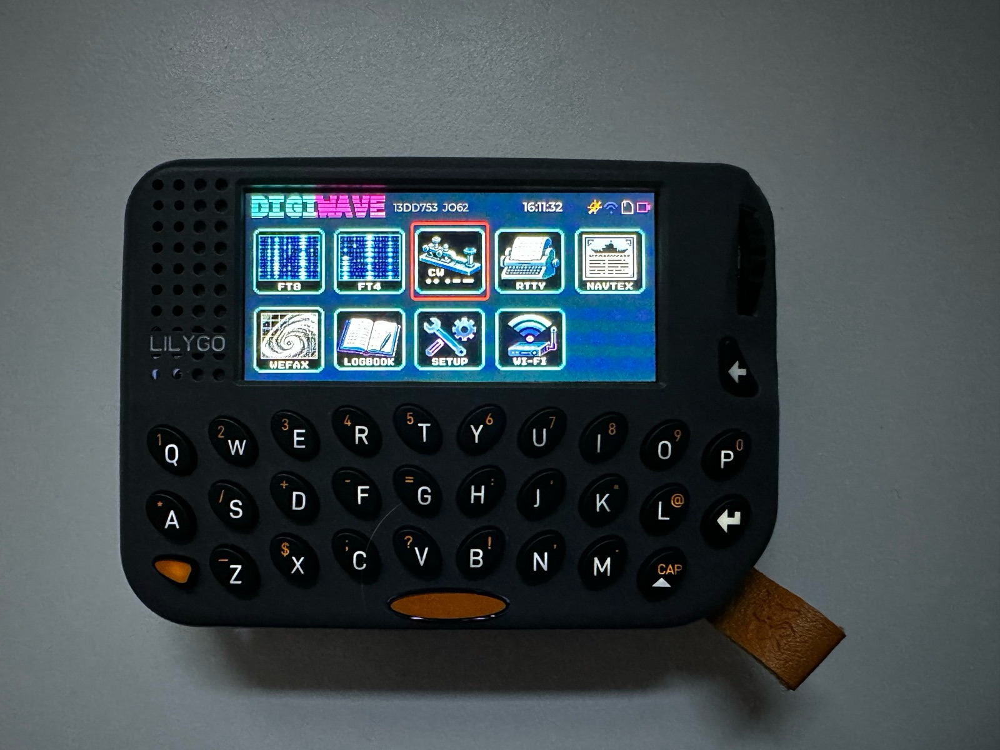

  

<h3 align="center">A pocket terminal for digital radio modes</h3>

  Firmware for the <a href="https://lilygo.cc/products/t-lora-pager">LilyGo T-LoRa Pager</a>:
  FT8, FT4, CW, RTTY, NAVTEX and WEFAX on a device that fits in a jacket pocket.

  

## What it does

DIGIWAVE listens to the audio of a radio, decodes what it hears and shows it on
the pager's display. In the modes that can transmit it also generates the audio
and keys the radio. No computer is involved.

<table>
  <tr>
    <td align="center"> <b>FT8</b></td>
    <td align="center"> <b>FT4</b></td>
    <td align="center"> <b>CW</b></td>
    <td align="center"> <b>RTTY</b></td>
    <td align="center"> <b>NAVTEX</b></td>
    <td align="center"> <b>WEFAX</b></td>
  </tr>
</table>

| Mode | Receive | Transmit |
| --- | --- | --- |
| FT8, FT4 | yes, with locator and country of each station | yes, with automatic QSO sequence and ADIF log |
| CW | yes, in a 100 Hz window that is moved with the wheel | yes, from the keyboard |
| RTTY (45.45 / 50 baud) | yes | yes |
| NAVTEX | yes | - |
| WEFAX (120 LPM) | yes, saved as BMP on the SD card | - |

### Features

- **Waterfall** under the decodes in FT8, FT4, CW, RTTY and NAVTEX
- **Full FT8/FT4 contacts**: call CQ or answer a station with one press; the
  sequence runs by itself and the contact is written to an ADIF logbook on the SD card
- **CB (11 m) operation** for FT8 and FT4: CB callsigns such as `26AT016`, the
  message sequence of WSJT-CB and the country list by division number
- **The own contact at a glance**: what is sent appears in the list with what
  is heard, and while calling or working a station the list shows just that
  contact (key V switches between it and everything heard)
- **Band and frequency for the logbook**: the radio is tuned by hand, so key B
  in FT8 and FT4 opens the list of the usual frequencies per band (or takes a
  typed one). FT8, FT4 and CB operation each remember their own
- **Exact time from GPS** with the pulse-per-second signal; the real-time clock
  takes over without reception
- **Locator from GPS**, or entered by hand
- **Phone page over Wi-Fi**: the pager opens its own access point and serves a
  page with the decodes, the main controls, received WEFAX pictures and the
  logbook download
- **Power saving**: the display goes off after three minutes without input, and
  the device goes to sleep when nothing is received either. Pressing the wheel
  wakes it. "Switch off" is in the setup

  

## Connecting a radio

Audio currently goes through the built-in microphone and speaker of the pager,
so it works held next to the speaker of any receiver. A small add-on board with
line-in, line-out and a PTT output for the 12-pin port is planned; the firmware
already keeps audio and PTT behind interfaces for it.

## Status

Work in progress.

- The signal processing of all modes is covered by 42 host tests.
- On the device, FT8 reception has been checked against real signals; a slot is
  decoded in about 0.7 s.
- NAVTEX and WEFAX have only been tested against generated signals.
- Transmitting has not been tested on air yet.

## Installing

DIGIWAVE is installed as one application next to others (for example Meshtastic)
with the [Launcher](https://github.com/bmorcelli/Launcher) by bmorcelli: build
the firmware, copy `.pio/build/pager/firmware.bin` to the SD card and install it
from the Launcher. `partitions.csv` describes the layout for a merged image if
the pager should run DIGIWAVE alone.

## Building

PlatformIO with the pioarduino platform (Arduino-ESP32 3.3):

    pio run -e pager        # firmware
    pio test -e native      # host tests of the signal processing

Artwork in `DIGIWAVE_Firmware_Grafiken` is converted with `python3 tools/make_assets.py`.

## Operating

| | |
| --- | --- |
| Wheel | select a tile, a station or a setting; in CW it moves the receive window |
| Wheel press | open, answer the selected station, edit a setting |
| Backspace | back |
| Space + key | digits and symbols |

The line at the bottom of each screen lists the keys of that screen.

## Layout of the repository

- `lib/ft8core` - hardware-independent decoders, encoders and QSO logic
- `lib/ft8_lib` - vendored [kgoba/ft8_lib](https://github.com/kgoba/ft8_lib) (MIT)
- `src` - firmware: audio and PTT interfaces, engine, user interface, web interface
- `test` - host tests and reference recordings from ft8_lib
- `PROJEKT.md` - description of the project in German

## Sources

- FT8/FT4 coding: ft8_lib by Karlis Goba (MIT)
- Board support: LilyGoLib by LilyGo (MIT)
- CB division list and message sequence: [WSJT-CB](https://github.com/vash909/WSJT-CB)
