

  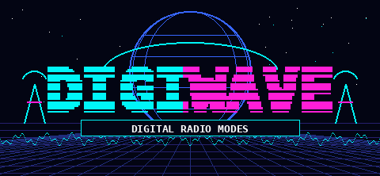

<h3 align="center">A pocket terminal for digital radio modes</h3>

  Firmware for the <a href="https://lilygo.cc/products/t-lora-pager">LilyGo T-LoRa Pager</a>:
  FT8, FT4, CW, RTTY, NAVTEX, WEFAX and SSTV on a device that fits in a jacket pocket.

  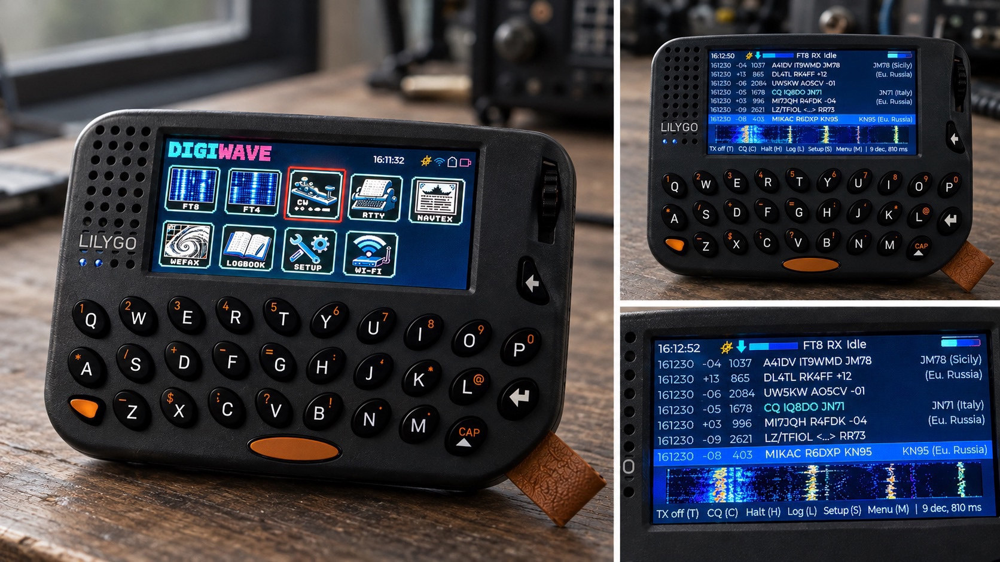

## What it does

DIGIWAVE listens to the audio of a radio, decodes what it hears and shows it on
the pager's display. In the modes that can transmit it also generates the audio
and keys the radio. No computer is involved.

<table>
  <tr>
    <td align="center">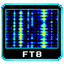 <b>FT8</b></td>
    <td align="center">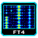 <b>FT4</b></td>
    <td align="center">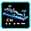 <b>CW</b></td>
    <td align="center"> <b>RTTY</b></td>
    <td align="center">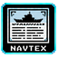 <b>NAVTEX</b></td>
    <td align="center">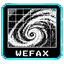 <b>WEFAX</b></td>
    <td align="center"> <b>SSTV</b></td>
  </tr>
</table>

| Mode | Receive | Transmit |
| --- | --- | --- |
| FT8, FT4 | yes, with locator and country of each station | yes, with automatic QSO sequence and ADIF log |
| CW | yes, in a 100 Hz window that is moved with the wheel | yes, from the keyboard |
| RTTY (45.45 / 50 baud) | yes | yes |
| NAVTEX | yes | - |
| WEFAX (120 LPM) | yes, saved as BMP on the SD card | - |
| SSTV (Martin 1/2, Scottie 1/2, Robot 36, PD 120/180) | yes, in colour, saved as BMP on the SD card | - |

### Features

- **Waterfall** under the decodes in FT8, FT4, CW, RTTY and NAVTEX
- **Full FT8/FT4 contacts**: call CQ or answer a station with one press; the
  sequence runs by itself and the contact is written to an ADIF logbook on the SD card
- **Worked before**: stations already in the logbook of the device are greyed
  out in the list, on this band or only on another one
- **CQ with an addition** (POTA, SOTA, DX, QRP ...), **distance** to every
  station heard, and **figures over the logbook**: QSOs per band and mode,
  countries, farthest contact
- **Weather by RTTY**: the frequencies of the German weather service DWD are in
  the RTTY list; choosing one sets speed and shift
- **CB (11 m) operation** for FT8 and FT4: CB callsigns such as `26AT016`, the
  message sequence of WSJT-CB and the country list by division number
- **The own contact at a glance**: what is sent appears in the list with what
  is heard, and while calling or working a station the list shows just that
  contact (key V switches between it and everything heard)
- **A free spot to transmit**: the spectrum of the last half minute shows
  where the band is quiet; key G moves the TX frequency there, key F tunes it
  with the wheel on the waterfall, and key E chooses the first or the second
  slots for calling CQ
- **Voice announcements** (optional): a new station calling CQ, a station
  calling you, a QSO started and logged, spoken through the pager's speaker
- **Band and frequency for the logbook**: the radio is tuned by hand, so key B
  in FT8 and FT4 opens the list of the usual frequencies per band (or takes a
  typed one). FT8, FT4 and CB operation each remember their own
- **Exact time from GPS** with the pulse-per-second signal. Without reception
  the phone page sets the clock from the phone's time, measured like NTP, and
  the real-time clock keeps it in between
- **Locator from GPS**, or entered by hand
- **Phone page over Wi-Fi**: the pager opens its own access point and serves a
  page with the decodes, the main controls, received WEFAX pictures and the
  logbook download. In the logbook, key Q shows QR codes that join the Wi-Fi
  and fetch the ADIF file
- **Home network**: set up from the phone without typing on the pager. Setup >
  Home Wi-Fi shows a code that joins the pager and one that opens a page
  listing the networks in reach, where the password is pasted. The pager then
  joins that network besides its own access point whenever its Wi-Fi is on,
  and answers there as `digiwave.local`. CBScope on a computer at home then
  takes the logbook over by itself (`/api/log` tells the size of the file,
  `/log.adi` serves it). With Wi-Fi off, the home network is left alone too
- **Broadcast plans** of the German weather service DWD for WEFAX and RTTY: the
  menu names the next broadcast and the plan counts down to it; the plans can
  be edited on the phone page
- **Battery** charge in the corner of the screen, from the fuel gauge checked
  against the voltage curve of the cell
- **Power saving**: the display goes off after three minutes without input, and
  the device goes to sleep when nothing is received either. Pressing the wheel
  wakes it. "Switch off" is in the setup

## Hardware: connecting a radio

  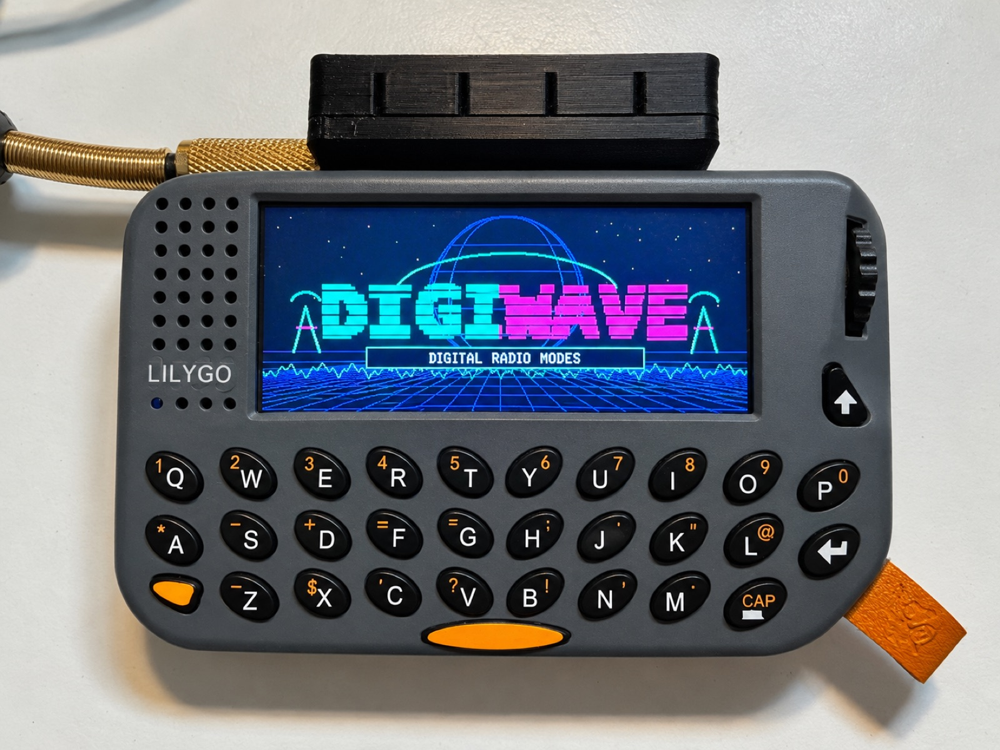

<table>
  <tr>
    <td width="40%">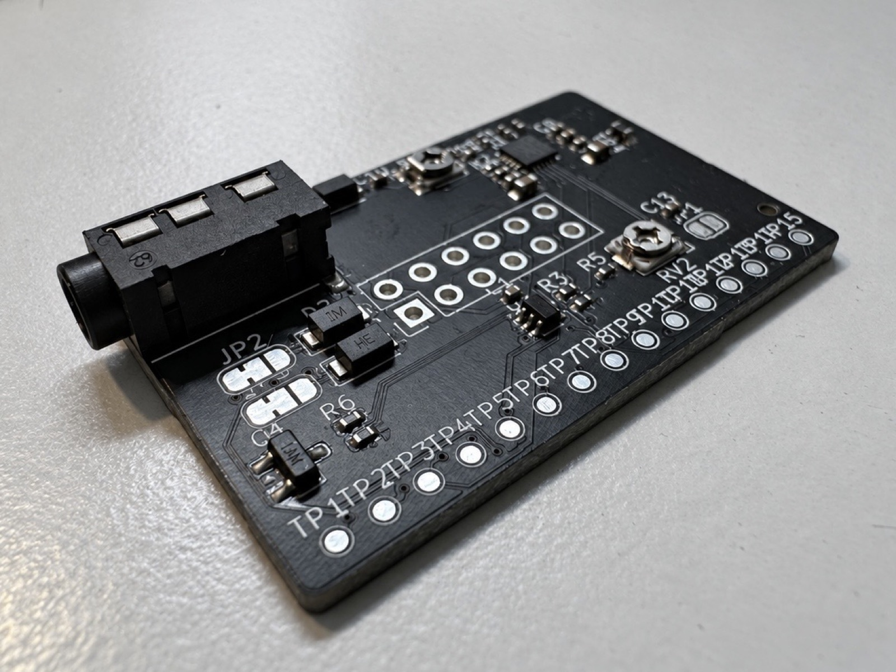</td>
    <td width="30%">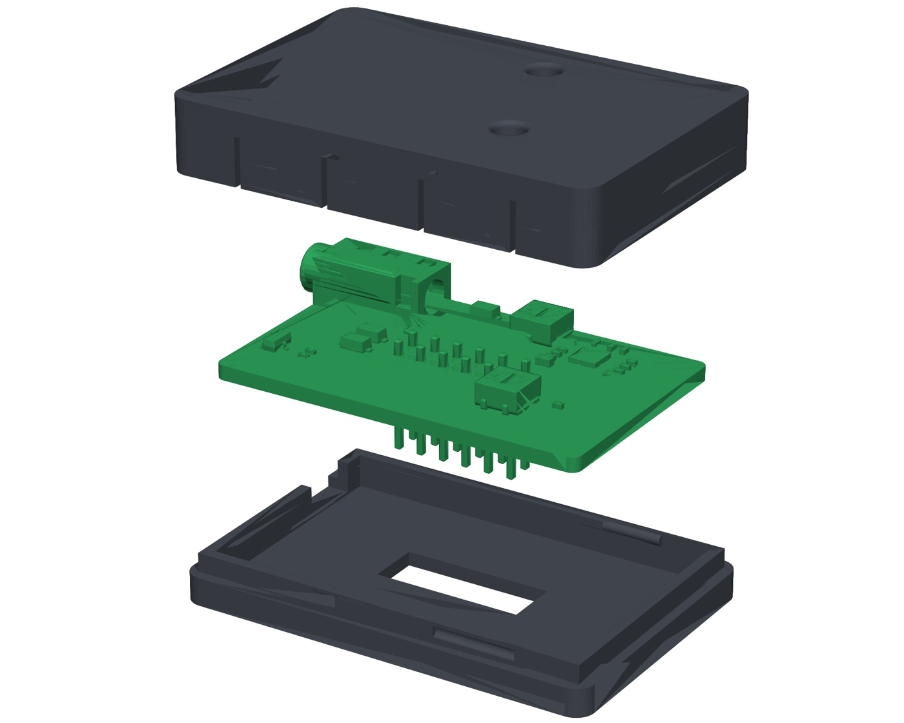</td>
    <td width="30%">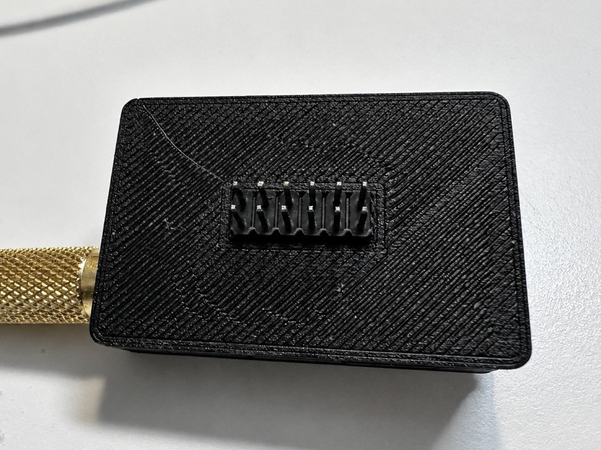</td>
  </tr>
</table>

A small interface board plugs into the pager's 12-pin port. It carries its own
ES8311 audio codec with line in, line out and a PTT output, and connects to
the radio with one TRRS cable wired like the Digirig. The firmware uses it
whenever it is plugged in (Setup, "Audio"); receive and transmit levels are set
in the setup and with the two trimmers, which can be reached through the lid of
its 3D-printed case.

Schematic, KiCad project, Gerber files with parts list, 3D views and the STL
files of the case are in [`hardware`](hardware), described on its own
[page](hardware/README.md).

Without the board, audio goes through the built-in microphone and speaker of
the pager, so reception works held next to the speaker of any receiver.

## Status

Work in progress.

- The signal processing of all modes is covered by 47 host tests.
- On the device, FT8 reception has been checked against real signals; a slot is
  decoded in about 0.7 s.
- NAVTEX and SSTV have only been tested against generated signals; WEFAX has
  received real weather charts.
- Transmitting works through the interface board: PTT keys the radio and FT8
  calls have gone out on the air.

## Installing

DIGIWAVE is installed as one application next to others (for example Meshtastic)
with the [Launcher](https://github.com/bmorcelli/Launcher) by bmorcelli: build
the firmware, copy `.pio/build/pager/firmware.bin` to the SD card and install it
from the Launcher. An update can also be written over USB straight into the
Launcher slot of DIGIWAVE, at the offset its partition table gives it:

    esptool.py write_flash 0x870000 .pio/build/pager/firmware.bin

Do not use `pio run -t upload` on a pager with the Launcher: it writes
`partitions.csv`, the layout for running DIGIWAVE alone, together with its own
bootloader, and so removes the Launcher and the other applications.

## Building

PlatformIO with the pioarduino platform (Arduino-ESP32 3.3):

    pio run -e pager        # firmware
    pio test -e native      # host tests of the signal processing

Artwork in `DIGIWAVE_Firmware_Grafiken` is converted with `python3 tools/make_assets.py`,
the voice announcements are spoken by [Piper](https://github.com/OHF-Voice/piper1-gpl)
with `tools/make_voice.py` (setup in the script).

## Operating

The same everywhere:

| | |
| --- | --- |
| Wheel | select or tune: a tile, a station, the CW receive window, the RTTY tones |
| Wheel press | in the menu: open. In a mode: the list of its functions, with the keys that do the same directly |
| Enter | the main action of the mode: call the selected station, send the typed line, save the received picture |
| Backspace | one step back: typed text first, then the open list or page, then from the mode to the menu |
| Space + key | digits and symbols |

FT8 and FT4 keep a line with their keys at the bottom of the screen; the other
modes use the whole screen for text, spectrum or picture.

Every WEFAX line is kept in memory (half an hour of reception), so a picture
can be saved as a whole at any time, and is saved by itself when the station's
stop tone ends it. Saved pictures can be looked at on the pager
(WEFAX functions, "Saved pictures") and are shown, downloaded and deleted on
the phone page.

## Layout of the repository

- `lib/ft8core` - hardware-independent decoders, encoders and QSO logic
- `lib/ft8_lib` - vendored [kgoba/ft8_lib](https://github.com/kgoba/ft8_lib) (MIT)
- `src` - firmware: audio and PTT interfaces, engine, user interface, web interface
- `test` - host tests and reference recordings from ft8_lib
- `hardware` - interface board (KiCad project, schematic, fabrication files) and printed case
- `PROJEKT.md` - description of the project in German

## Licence and credits

Copyright (C) 2026 Andres Leroi

DIGIWAVE is free software: you can redistribute it and/or modify it under the
terms of the GNU General Public License as published by the Free Software
Foundation, either version 3 of the License, or (at your option) any later
version. It comes without any warranty. The text is in [`LICENSE`](LICENSE).

The hardware in [`hardware`](hardware), interface board and case, is licensed
under the CERN Open Hardware Licence Version 2 - Strongly Reciprocal
(CERN-OHL-S-2.0), text in [`hardware/LICENSE`](hardware/LICENSE).

It stands on the work of others:

- **FT8 and FT4** are protocols by Joe Taylor K1JT and Steve Franke K9AN;
  coding and decoding come from [ft8_lib](https://github.com/kgoba/ft8_lib) by
  Kārlis Goba (MIT)
- **CB operation** follows [WSJT-CB](https://github.com/vash909/WSJT-CB), from
  which the list of 11 m divisions is taken (GPL-3.0)
- **The voice announcements** are spoken by Piper (GPL-3.0) with the voice
  ljspeech, trained on the public-domain LJ Speech dataset
- **The device** is driven through [LilyGoLib](https://github.com/Xinyuan-LilyGO/LilyGoLib)
  (MIT), the display through [LVGL](https://github.com/lvgl/lvgl) (MIT) with
  the Montserrat typeface (SIL Open Font License)
- **The platform** is the Arduino core for ESP32 (LGPL-2.1) on ESP-IDF (Apache-2.0)

The complete list with versions, authors and licences is in
[`THIRD-PARTY-NOTICES.md`](THIRD-PARTY-NOTICES.md). The same credits are shown
on the device under Setup, "About DIGIWAVE".
