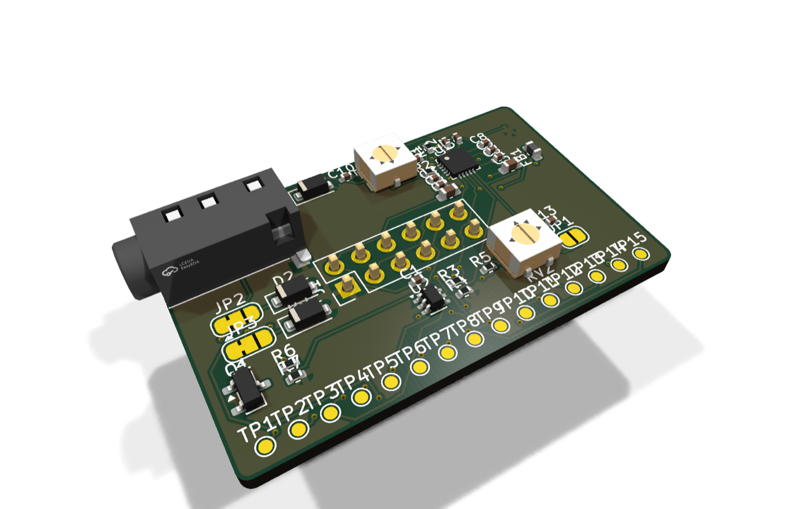
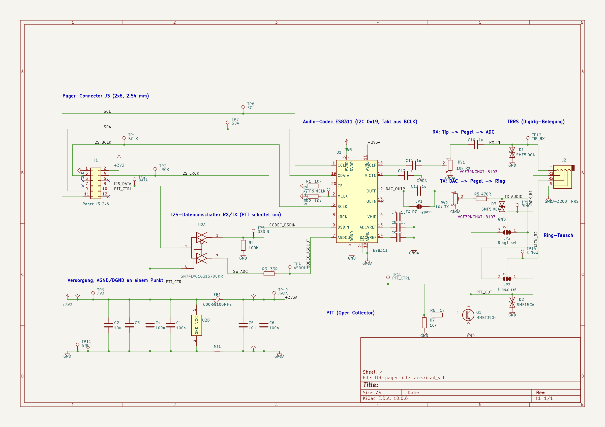

  

<h3 align="center">DIGIWAVE interface board</h3>

  Line in, line out and PTT for the LilyGo T-LoRa Pager, in a small case that
  plugs into the pager's 12-pin port. One TRRS cable goes to the radio.

## What it does

The pager has no audio connection for a radio. The board adds one: its own
ES8311 audio codec, clocked and fed over I²S from the 12-pin port, a 3.5 mm
TRRS jack for the radio and an open-collector PTT output. DIGIWAVE finds the
board at start-up and uses it instead of the built-in microphone and speaker
(Setup, "Audio").

<table>
  <tr>
    <td width="50%"></td>
    <td width="50%"></td>
  </tr>
  <tr>
    <td align="center">The assembled board</td>
    <td align="center">The same board in KiCad's 3D view</td>
  </tr>
</table>

- **Audio codec** ES8311 at I²C address 0x19 (the pager's own codec is at 0x18).
  It has no MCLK and derives its clock from BCLK.
- **One data line for both directions**: the port offers a single pin for audio
  data, so an analogue switch (SN74LVC1G3157) connects it to the codec's ADC
  while receiving and to its DAC while the PTT line is set
- **Receive**: tip of the jack → protection → trimmer RV1 → codec input
- **Transmit**: codec output → trimmer RV2 → 470 Ω → ring of the jack
- **PTT**: MMBT3904 as open collector, protected up to 15 V
- **Protection** on every line to the radio with TVS diodes
- **Supply** from the pager's 3.3 V; analogue supply through a ferrite bead,
  analogue and digital ground joined at one point

## Schematic

  

The schematic as [PDF](interface-board/schematic.pdf); the KiCad 10 project is in
[`interface-board`](interface-board).

## Connections

### Pager port J3 (2 × 6, 2.54 mm)

| Pin | Signal | Use on the board |
| --- | --- | --- |
| 1 | GND | ground |
| 2 | 3V3 | supply |
| 3 | GPIO43 | I²S BCLK |
| 4 | GPIO44 | I²S LRCK |
| 8 | GPIO9 | I²S data, both directions |
| 9 | SDA | I²C to the codec |
| 10 | XL9555 P11 | PTT_CTRL: keys the radio and switches the data line to the DAC |
| 11 | SCL | I²C to the codec |
| 5, 6, 7, 12 | SPI, VBUS | not used |

### Radio jack J2 (3.5 mm TRRS)

The jack is wired like the [Digirig](https://digirig.net/), so the cables made
for it fit:

| Contact | Signal |
| --- | --- |
| Tip | audio from the radio (RX) |
| Ring 1 | audio to the radio (TX) |
| Ring 2 | PTT |
| Sleeve | ground |

### Jumpers, trimmers and test points

| Part | Purpose |
| --- | --- |
| JP2, JP3 | Ring swap. As delivered (1–2 bridged), ring 1 carries TX audio and ring 2 the PTT. Bridging 2–3 on both swaps them |
| JP1 | open: TX audio through a capacitor. Bridged: DC-coupled, for radios that need it |
| RV1 | receive level |
| RV2 | transmit level. If PTT keys the radio but nothing is heard, turn this up first |
| TP1–TP15 | BCLK, LRCK, DATA, ASDOUT, DSDIN, MCLK, SDA, SCL, 3V3, 3V3A, GND, TIP_RX, RING1, RING2, PTT_CTRL |

## Case

<table>
  <tr>
    <td width="50%"></td>
    <td width="50%"></td>
  </tr>
  <tr>
    <td align="center">Base, board and lid</td>
    <td align="center">From below: the header goes into the pager</td>
  </tr>
</table>

Two printed parts, 45.4 × 30.4 mm, 10.5 mm high when closed. The 12-pin
header comes out through the window in the base and plugs straight into the
pager. The lid has openings over both trimmers, so the levels can be set with
the case closed. The jack is reached from the side.

GitHub shows STL files as a 3D model that can be turned with the mouse:

- [`case/case-base.stl`](case/case-base.stl), base
- [`case/case-lid.stl`](case/case-lid.stl), lid
- [`interface-board/interface-board.stl`](interface-board/interface-board.stl), the assembled board

## Building one

The board was made and assembled by JLCPCB. Everything needed for the order is
in [`interface-board/fabrication`](interface-board/fabrication):

| File | Content |
| --- | --- |
| `gerber.zip` | Gerber and drill files, two layers |
| `bom-jlcpcb.csv` | parts list with LCSC part numbers |
| `cpl-jlcpcb.csv` | placement file |

The 12-pin header is fitted by hand, pointing down out of the board. The board as a whole is also
available as [STEP](interface-board/interface-board.step) for designing other
cases.

## Files

| Path | Content |
| --- | --- |
| `interface-board/ft8-pager-interface.kicad_pro`, `.kicad_sch`, `.kicad_pcb` | KiCad 10 project |
| `interface-board/lib/ft8_pager.kicad_sym` | symbols of ES8311, analogue switch and jack |
| `interface-board/schematic.pdf` | schematic |
| `interface-board/interface-board.step`, `.stl` | 3D model of the assembled board |
| `interface-board/fabrication` | Gerber files, parts list and placement for JLCPCB |
| `case/case-base.stl`, `case/case-lid.stl` | case for 3D printing |

The 3D model of the jack (PJ-320D, LCSC C22459515) comes from the EasyEDA
library and is not in the repository; the KiCad project shows the board
without it until `lib/3d/PJ-320D.step` is added. The exported STEP and STL
include it.

The firmware side is in `src/hal/audio_es8311.cpp` (codec and data line) and
`src/hal/ptt_xl9555.cpp` (PTT).

## Licence

Copyright (C) 2026 Andres Leroi. The hardware design is published under the same
licence as the rest of the repository, the GNU General Public License,
version 3 or later. The footprints and 3D models of the KiCad libraries are
used under their licence (CC-BY-SA 4.0 with an exception that leaves designs
made with them free).
